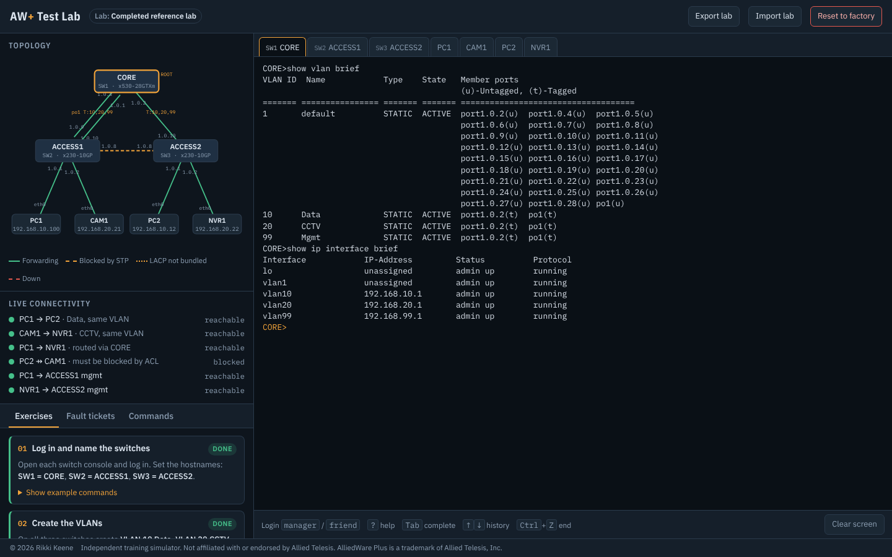
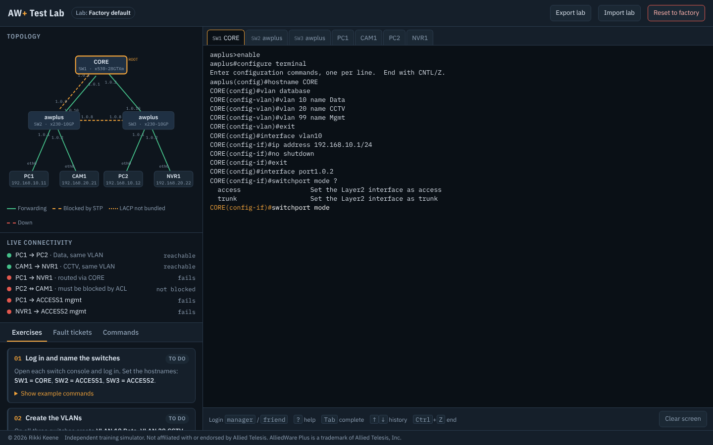
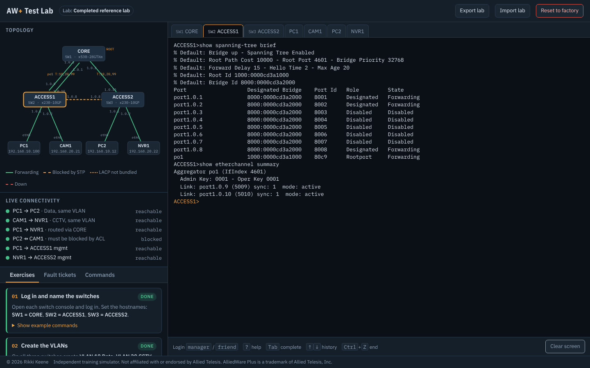
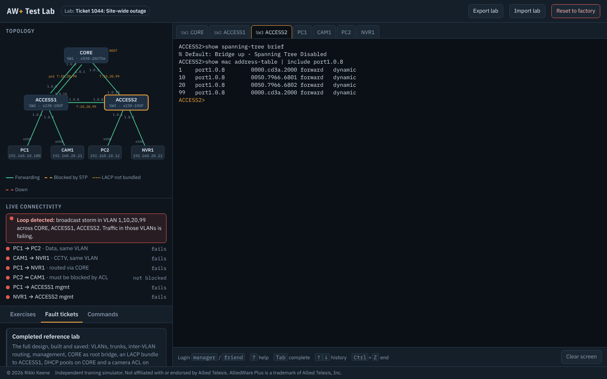
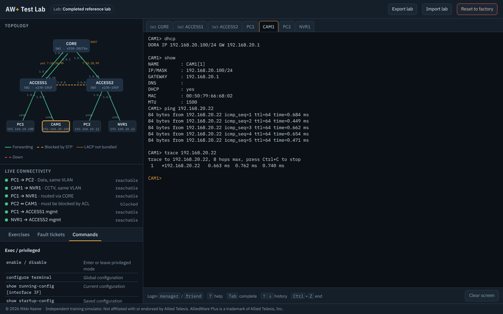

# AW+ Test Lab

**Practise AlliedWare Plus style switch configuration in your browser.** Three switches, four end devices, real CLI behaviour and live connectivity checks, all in one self-contained `index.html`. No install, no server, no switch images.

**[▶ Open the live lab](https://claude.ai/artifact/6iULQJ7CAKa4VqzqzrBqWJ)** &nbsp;·&nbsp; or download `index.html` and open it in any modern browser.



Created by Rikki Keene. © 2026 Rikki Keene.

> Independent training simulator. Not affiliated with or endorsed by Allied Telesis. AlliedWare Plus is a trademark of Allied Telesis, Inc. This project contains no Allied Telesis software.

## Why use it

- **Hands-on from minute one.** Log in as `manager` / `friend` and start typing. Modes, abbreviations, `?` help, Tab completion and `^` error markers behave the way you'd expect on a real switch.
- **See the network react.** The topology diagram redraws link states as you work (forwarding, blocked by spanning tree, LACP not bundled, down), and six reachability checks update after every command.
- **Guided, then on your own.** 13 exercises build a full VLAN design step by step; six fault tickets drop you into a broken network to troubleshoot.
- **Safe to break.** Cause a broadcast storm, lock yourself out with an ACL, erase the config, then reset or restore from a backup.

## Screenshots

| Build a config from factory defaults | Spanning tree and LACP on ACCESS1 |
|---|---|
|  |  |
| Configure terminal, VLAN database, interfaces and context `?` help. | Root port on the LACP bundle, cross link blocked, both members in sync. |

| Fault ticket: site-wide broadcast storm | End devices: DHCP, ping and trace |
|---|---|
|  |  |
| Spanning tree is off on ACCESS2, so the redundant links loop and every check fails. | A camera picks up its address from the CORE DHCP pool and reaches the NVR. |

## Topology

```
                 CORE (SW1, x530-28GTXm)
       port1.0.1 + port1.0.3       port1.0.2
                 ||                    |
       port1.0.10 + port1.0.9      port1.0.10
       ACCESS1 (SW2, x230-10GP) -- ACCESS2 (SW3, x230-10GP)
                       port1.0.8 <-> port1.0.8
       port1.0.1   port1.0.2      port1.0.1   port1.0.2
          |           |              |           |
         PC1        CAM1            PC2        NVR1
  192.168.10.11  192.168.20.21  192.168.10.12  192.168.20.22
```

Switch login: `manager` / `friend`

## What it simulates

- AW+ style CLI with modes (`>`, `#`, `(config)#`, `(config-if)#`, `(config-vlan)#`), abbreviated commands, `?` help, Tab completion, history, `do`, and `^` error markers
- VLAN database, access ports, trunks (allowed / native VLANs), port and VLAN interface shutdown and descriptions
- VLAN interfaces with IP addressing, inter-VLAN routing, static routes
- `show running-config`, `startup-config`, `vlan brief`, `interface brief|switchport|IF`, `ip interface brief`, `ip route`, `lldp neighbors`, `mac address-table`, `version`, `system`, `clock`
- `write`, `copy running-config startup-config`, `erase startup-config`, `reload`
- Rapid spanning tree (single instance): root election, bridge and port priority, path cost, root / designated / alternate roles, edge ports, `show spanning-tree [brief]`
- Link aggregation: LACP (`channel-group N mode active|passive`, `poN`) and static (`static-channel-group N`, `saN`), `show etherchannel [summary]`, `show static-channel-group`
- Loop detection: if spanning tree is disabled or misconfigured, redundant links cause a broadcast storm and traffic in the affected VLANs fails
- Hardware IP ACLs: `access-list 3000-3699 permit|deny ip|icmp SRC DST` (`A.B.C.D/M`, `host A.B.C.D`, `any`), applied inbound with `access-group`, unmatched traffic permitted; `show access-list`
- DHCP server: `ip dhcp pool` with `network`, `range`, `default-router`, `dns-server`, `lease`; `service dhcp-server`; `show ip dhcp pool|binding`; `clear ip dhcp binding all`
- Everyday sandbox commands:
  - Output filters on any command: `| include`, `| exclude`, `| begin`
  - `show log` (logins, link and spanning tree changes, config commands), `show interface status`, `show arp`, `show lldp neighbors detail`, `show users`, `show history`, `show cpu`, `show memory`, `show system environment`
  - Files and backups: `dir`, `copy running-config FILE.cfg`, `copy FILE.cfg running-config|startup-config`, `show file`, `delete`, `show boot`. Saved configs are replayed through the CLI, so any running-config can be restored
  - Remote sessions between switches with `telnet` and `ssh [user NAME]`, honouring reachability, ACLs and whether the server is enabled
  - Local users with privilege levels, `banner motd`, `service ssh|telnet`, `clock set`, `clock timezone`, NTP client and master, SNMP agent, communities, location and contact, DNS name servers, line exec-timeout
  - Port `speed` and `duplex`; mismatched fixed speeds bring the link down
- `ping` (with `repeat N`) and `traceroute` computed from the real L2/L3 state of the lab
- End devices with a simple host shell (`ip`, `dhcp`, `show`, `ping`, `trace`)

## Coursework

- **Exercises:** 13 guided tasks that build a Data (VLAN 10), CCTV (VLAN 20) and Management (VLAN 99) design, then make CORE the root bridge, bundle the ACCESS1 uplinks with LACP, set edge ports, lock the cameras down with an ACL and hand out addresses by DHCP. Each is checked live.
- **Fault tickets:** pre-broken labs to troubleshoot (CCTV outage, PC offline, unmanageable switch, site-wide broadcast storm, LACP bundle down, camera with no DHCP address), plus a completed reference lab.
- **Live connectivity:** six reachability checks update after every command.

Progress is kept in the browser's local storage. Use **Export lab** / **Import lab** to move a lab between machines.

## Not yet simulated

MSTP, per-VLAN spanning tree, DHCP relay, OSPF, AMF, TCP/UDP port matching in ACLs, timers (spanning tree converges instantly).

## Run it locally

Download or clone the repo and open `index.html` in Chrome, Edge, Firefox or Safari. Everything (styles, engine, scenarios) is inline, so it also works offline from a USB stick or a shared drive.

## Tests

```
npm install playwright
node tests/engine-test.js     # engine and scenario assertions
node tests/ui-check.js        # quick UI smoke test
node tests/screenshots.js     # regenerate the README screenshots
```

The engine test loads every scenario and confirms the expected pass/fail pattern for the connectivity checks and exercises, then exercises the CLI parser and takes a screenshot.

## Credits

© 2026 Rikki Keene. Independent training simulator, not affiliated with or endorsed by Allied Telesis.
